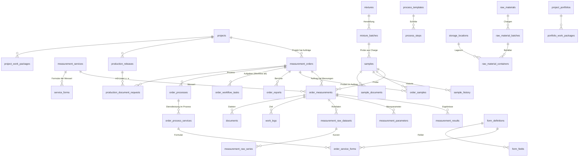

# Aufgabe 017: Bestandsaufnahme Datenbank-Struktur

Stand: 20.11.2026. **Nur Analyse – es wurde nichts geändert** (keine Migration, keine Änderung an Tabellen, Rechten oder Daten).
Kein Zugriff auf Ceram-Repo, Lovable oder Prod; alle Aussagen stammen aus dem Dev-Repo (`src/`, `supabase/`, `drizzle/`, `scripts/`).

## 0. Grundlage und Grenzen

- **180 Tabellen** im Schema `public` (laut `src/integrations/supabase/types.ts`); 173 davon werden in den Migrationen angelegt (`supabase/migrations`: 206 Dateien, `drizzle/migrations`: 49 Dateien).
- **Code-Analyse** (`.from("tabelle")`, Namensnennung in `src/`, `supabase/functions/`, `scripts/` und in SQL-Funktionen/Triggern der Migrationen) ist **statisch** (Text-Suche). Dynamisch zusammengesetzte Tabellennamen würden nicht erkannt; die Angaben „ungenutzt“ sind deshalb Hinweise, keine Beweise.
- **Echte Zeilenzahlen, Größen und „leer/nicht benutzt“** liefert erst die Abfrage `tasks/017-tabellen.sql` (nur SELECT, eine Abfrage). Bitte im Dev-Studio ausführen und das Ergebnis als `tasks/017-tabellen.csv` ablegen; dann ergänze ich Abschnitt 3 mit Zahlen.
- Die Aufteilung unten ist meine fachliche Gruppierung nach Tabellennamen und Fremdschlüsseln.

## 1. Übersicht in Gruppen

| Gruppe | Tabellen | Zweck (1 Satz) |
|---|---|---|
| **Aufträge** | 23 | Kopf und Bestandteile eines Auftrags: Messaufträge mit ihren Messungen/Proben, Berichte, Dateien, Prozess- und Workflow-Ausführung, Technikumsblöcke, Fertigungsunterlagen-Anfragen. |
| **Proben** | 4 | Die Proben selbst mit Historie, Dokumenten und Geometriedaten. |
| **Messungen und Ergebnisse** | 21 | Messarten (Dienstleistungen), Ergebniswerte, Messparameter, Rohdaten/Kurven, Korrekturen, Import, Zeitbuchung, Prüfmittel und Arbeitsplätze. |
| **Formulare, Dienstleistungen, Abläufe** | 44 | Formular-Designer (Felder, Berechnungen, Rechte), globale Bibliothek, Dienstleistungs-Konfiguration (Pakete, Workflows, Regeln) und Prozessvorlagen. |
| **Projekte und Portfolios** | 33 | Projekte mit Arbeitspaketen, Meilensteinen, Kosten, Berichten und die übergeordneten Portfolios mit eigenen Arbeitspaketen. |
| **Rohstoffe, Mischungen, Lager** | 29 | Rohstoffe, Chargen, Behälter, Lagerorte, Mischungen/Rezepturen/Herstellung, Gefahrenmeldungen und Etiketten. |
| **Fertigungsfreigaben** | 7 | Freigaben für die Fertigung (Vorgaben/Sollwerte aus Kundendokumenten) samt Import und Änderungen. |
| **Benutzer und Rechte** | 12 | Profile, Rollen und Berechtigungen, Fachkompetenzen, Abwesenheiten/Arbeitszeiten, Kunden/Kontakte, Benachrichtigungen. |
| **Sonstiges / System** | 7 | Aktivitätsprotokoll, zentrale Änderungshistorie (`historian`), Nutzungsereignisse, Firmen-/Sync-Einstellungen, eigene Symbole, Hilfstabelle der Prüfmittelfunktionen. |

Wichtigste Drehscheiben (meiste eingehende Fremdschlüssel): `projects` (28), `measurement_services` (23), `measurement_orders` (18), `raw_materials` (16), `form_definitions` (13), `order_measurements` (13), `samples` (10).

### Die Kernkette (so hängen Auftrag, Probe und Messung zusammen)
Ein **Auftrag** (`measurement_orders`) gehört zu einem **Projekt**, enthält mehrere **Messungen** (`order_measurements`, je Messart und Probe) und verknüpft **Proben** über `order_samples`. Die Ergebnisse hängen an der Messung (`measurement_results`, `measurement_parameters`, `measurement_raw_datasets`).
Achtung zur Namensgebung: `measurement_orders` = **Auftrag**, `order_measurements` = **Messung im Auftrag** – das ist leicht zu verwechseln.

## 2. Diagramm der Hauptbeziehungen (vereinfacht)

## 3. Ungenutzte oder leere Tabellen

**Leere Tabellen** lassen sich erst mit `tasks/017-tabellen.csv` sagen (Spalte `zeilen = 0`; Spalten `gelesen`/`geschrieben` zeigen Nutzung seit dem letzten Statistik-Reset). Aus dem Code allein ergibt sich:

### A) Kein Zugriff aus der Anwendung (nur Datenbank oder gar nicht)
| Tabelle | Befund |
|---|---|
| `form_definition_versions`, `form_import_mappings`, `form_import_runs`, `form_value_history` | Nur in den Typen vorhanden – **in keiner Migration des Repos angelegt**, nie von App, Funktionen oder Skripten benutzt (`form_value_history` wird nur in einem Kommentar der Lösch-Trigger erwähnt). Herkunft unklar (vermutlich aus einer früheren Konfiguration/Werkzeug). **Hauptkandidaten für Aufräumen.** |
| `historian` | Zentrale Änderungshistorie (`drizzle/0024`), wird von Datenbankfunktionen beschrieben, **die App liest sie nie**. Behalten, aber prüfen, ob sie jemand auswertet. |
| `order_form_versions` | Nicht im Repo angelegt; nur von den Lösch-Triggern (0035/0046) genutzt, die ihre Zeilen beim Löschen eines Auftrags sichern. |
| `form_field_rules` | Nur von der Datenbankfunktion `clone_global_form` (Formular klonen) benutzt; keine Oberfläche greift direkt darauf zu. |
| `mixture_batch_consumptions` | Wird nur von Datenbankfunktionen (Chargenherstellung) beschrieben; keine App-Abfrage. |
| `measurement_import_operations` | Nur von den Korrekturfunktionen (`replace_measurement_results` u. a.) genutzt. |
| `reference_number_sequences` | Nur eine SQL-Funktion (Referenznummern); keine App-Abfrage. |
| `equipment_rpc_guard` | Hilfstabelle der Prüfmittel-Funktionen (Schutz vor direkten Schreibzugriffen) – **muss bleiben**. |

→ Von diesen sind fachlich nötig: `historian`, `order_form_versions`, `form_field_rules`, `mixture_batch_consumptions`, `measurement_import_operations`, `reference_number_sequences`, `equipment_rpc_guard` (alle werden von Datenbankfunktionen gebraucht). **Nur die vier „form_…“-Tabellen ohne jede Nutzung sind echte Aufräumkandidaten.**

### B) Nur indirekt angesprochen (also in Gebrauch)
Viele Tabellen tauchen im Code nur als Textname in einer Hilfsschicht (`src/lib/api/…`) auf, nicht als direktes `.from("…")` – sie sind **in Gebrauch**: z. B. alle `portfolio_*`/`project_portfolio_*`, `measurement_cases*`, `measurement_raw_*`, `global_*`, `service_dependencies`, `service_form_links`, `workflow_*`.

### C) Mit hoher Wahrscheinlichkeit selten/leer (bitte mit CSV prüfen)
`usage_events` (nur Schreiben), `custom_symbols`, `sync_settings`, `password_reset_log`, `mdl_permission_audit_log`, `project_lessons_learned`, `project_decisions`, `project_stakeholders`, `project_weekly_reviews`, `project_closure_reports`, `project_change_requests`, `service_versions`, `service_blocks`, `hazard_notification_*`. Das sind Funktionen mit eigener Oberfläche, die vermutlich nur gelegentlich genutzt werden.

## 4. Doppelte oder überschneidende Tabellen

1. **Drei bis vier Generationen von „Abläufen/Workflows“** nebeneinander:
   - alt: `order_workflow_instances`, `order_workflow_tasks`, `order_workflow_task_positions` (+ `service_workflow_definitions/steps/step_services`, `service_workflows`, `workflow_templates`, `workflow_template_steps`)
   - neu: `order_instances`, `order_step_runs`, `order_step_positions` (+ `process_templates`, `process_steps`)
   - Prozess/Dienstleistung: `order_processes`, `order_process_services`, `order_service_forms` (+ `process_service_links`, `workflow_process_links`, `service_package_workflow_map`)
   Alle sind noch im Code verdrahtet, die Lösch-/Bearbeitungsfunktionen müssen alle bedienen. **Größte Komplexitätsquelle.**
2. **Formular-Felder an vier Stellen:** `form_fields`, `service_data_fields`, `service_parameter_definitions` und `service_field_templates` (+ `global_fields`, `global_objects`, `global_lists…`); dazu `measurement_parameters` als gespeicherte Werte. Verwandte Aufgaben mit leicht verschiedenen Modellen.
2b. **Formular-Anbindung:** `service_forms`, `service_form_layouts`, `service_form_links`, `order_kind_form_templates`, `order_service_forms` verbinden Formulare mit Messarten/Aufträgen auf unterschiedlichen Wegen.
3. **Projekt gegen Portfolio:** `project_work_packages`/`project_milestones`/`project_members`/`project_documents` und parallel `portfolio_work_packages`/`portfolio_tasks`/`project_portfolio_members`/`…milestones`/`…documents`, verbunden über zwei Abbildungstabellen (`portfolio_task_project_wp_map`, `portfolio_wp_project_wp_map`).
4. **Zeiterfassung:** `work_logs` (Zeit je Messung) und `project_time_entries` (Zeit je Projekt/Auftrag) erfassen Ähnliches an zwei Stellen.
5. **Dokumente:** `documents`, `order_upload_files`, `sample_documents`, `raw_material_documents`, `project_documents`, `project_portfolio_documents`, `service_document_templates`, `order_reports`/`order_report_versions` – gleiche Idee („Datei hängt an X“), sechs bis acht eigene Tabellen.
6. **Protokolle/Historien:** `activity_log`, `historian`, `order_audit_log`, `container_audit_log`, `mdl_permission_audit_log`, `portfolio_structure_audit_log`, `project_change_log`, `sample_history`, `container_location_history`, `label_print_history`, `password_reset_log`, `hazard_notification_log`, `usage_events` – dreizehn „Logbuch“-Tabellen.
7. **Lagerbewegungen:** `inventory_movements` (Rohstoffe), `container_movements`, `mixture_inventory_movements` – drei Bewegungs-Tabellen mit ähnlichem Aufbau.
8. **Benennung:** `measurement_orders` (Auftrag) und `order_measurements` (Messung) sind leicht zu verwechseln.

## 5. Vorschläge zur Vereinfachung (nichts davon ist umgesetzt)

| # | Vorschlag | Nutzen | Aufwand | Risiko |
|---|---|---|---|---|
| 1 | **CSV auswerten** (`tasks/017-tabellen.csv`): leere/ungelesene Tabellen sicher benennen. | Basis für alles Weitere | klein | keins (nur Lesen) |
| 2 | **Vier „form_…“-Tabellen ohne Nutzung** (`form_definition_versions`, `form_import_mappings`, `form_import_runs`, `form_value_history`) prüfen und – wenn leer – per eigener Migration entfernen (inkl. Typen). | weniger Altlast | klein | **mittel**: Herkunft unbekannt, evtl. von externen Werkzeugen genutzt; Prod-Übertragung braucht Freigabe durch Stefan |
| 3 | **Glossar/Datenmodell-Doku** (`docs/`): Kernkette, Namensverwechslung `measurement_orders`/`order_measurements`, Gruppen und Drehscheiben; Schema-Diagramm bei jeder Migration mitpflegen. | schnelleres Verstehen, weniger Fehler | klein | keins |
| 4 | **Workflow-Generationen klären:** mit der CSV feststellen, welche Generation noch Daten bekommt; ältere als „eingefroren“ kennzeichnen (Kommentar/Doku), später zusammenführen. | größte Entlastung bei Lösch- und Bearbeitungsfunktionen | **groß** | **hoch** (Daten, Berichte, viele Funktionen) – nur schrittweise, mit Tests auf Dev |
| 5 | **Portfolio/Projekt:** klären, ob die Portfolio-Struktur produktiv genutzt wird; falls nein, stilllegen statt umbauen. | weniger Tabellen, einfachere Rechte | mittel | mittel |
| 6 | **Zeiterfassung vereinheitlichen** (`work_logs` und `project_time_entries`). | eine Wahrheit für Zeiten | mittel | mittel (Berichte, Rechte) |
| 7 | **Dokumente und Protokolle** nicht zusammenlegen, sondern **Regeln** festlegen (gleiche Spalten, gleiche Rechte, gleiche Lösch-Logik). | weniger Sonderfälle | mittel | niedrig |
| 8 | **Prüfroutine (db-integrity-check)** um eine Tabellen-Inventur erweitern (nur lesen). | frühe Warnung vor Wildwuchs | klein | niedrig |

**Empfehlung zur Reihenfolge:** 1 → 3 → 2 → 8; die großen Themen (4, 5, 6) erst nach Sichtung der Zahlen und nur einzeln entscheiden.
