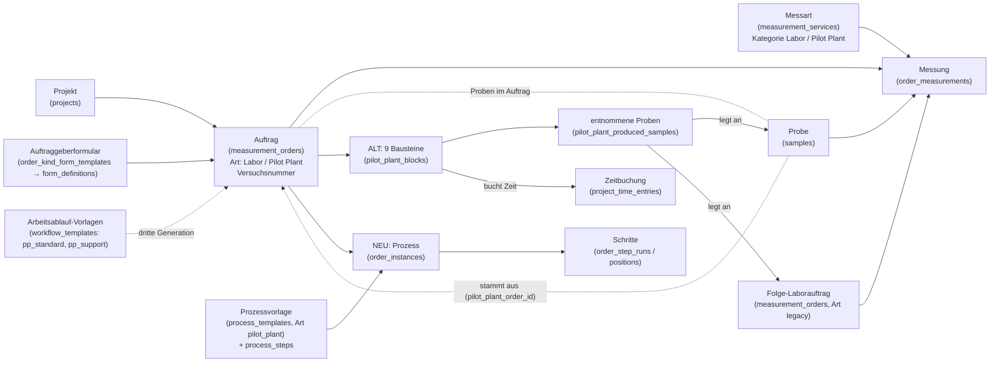

# Aufgabe 018: Bereich „Pilot Plant & Prototyping“ – Bestandsaufnahme (Schritt 1, nur Analyse)

Stand: 20.11.2026. **Nichts geändert** (keine Tabelle gelöscht, keine Daten, keine Rechte, kein Code). Nur Dev-Repo.
Die **Zahlen aus der Dev-Datenbank** (`tasks/archiv/018-pilotplant-sql-ergebnis.txt`, Abfrage `tasks/archiv/018-pilotplant.sql`) sind in **Abschnitt 3a** eingearbeitet; sie verändern die Empfehlung deutlich. Alle anderen Aussagen stammen aus dem Code.
**Wichtig:** Die Zahlen gelten für die **Dev-Datenbank**. Ob es in der Produktion genauso aussieht, ist **nicht geprüft** (kein Zugriff) – vor jeder Entfernung muss das dort gesondert festgestellt werden.

Hinweis zum Namen: „**Prototyping**“ kommt im Code **nirgends** vor. Der Bereich heißt in der Oberfläche „**Pilot Plant**“ bzw. „**Technikum**“ (beide Wörter werden gemischt benutzt).

## 1. Erklärt in einfachen Worten

Die **Pilot Plant (Technikum)** ist die kleine Versuchsanlage: Dort wird Masse hergestellt – verwiegen, kneten, extrudieren, trocknen, brennen – und daraus werden **Proben** entnommen, die danach im **Labor** gemessen werden. Die Software bildet das an vier Stellen ab:

1. **Auftragsart.** Beim Anlegen eines Auftrags wählt man „Labor“ oder „Pilot Plant“. Bei Pilot Plant gelten andere Regeln: nur Pilot-Plant-Dienstleistungen, ein eigenes Auftraggeberformular, eine **Versuchsnummer** (`pp_experiment_number`), ein gruppierter **Laufzettel**, und es sind **keine Proben vorab nötig** (die Proben entstehen ja erst im Versuch).
2. **Messart-Kategorie.** Jede Dienstleistung (z. B. Extrusion, Trocknen, Brennen, Festigkeit) ist entweder „Labor“ oder „Pilot Plant/Technikum“.
3. **Der Ablauf der Herstellung – hier gibt es zwei Systeme nebeneinander:**
   - **ALT: neun feste „Bausteine“** (Stammdaten, Rezeptur, Knetung, Extrusion, Trocknung, Brennen, Probenentnahme, Übergabe, Abschluss). Zu sehen als Reiter „Pilot Plant“ im Auftrag. Beim Abschluss des Bausteins „Probenentnahme“ legt die Datenbank **automatisch Proben und Folge-Laboraufträge** an; für jeden Baustein wird Arbeitszeit gebucht.
   - **NEU: „Prozess“ mit Schritten** aus frei konfigurierbaren **Prozessvorlagen** (`process_templates`, Art „Pilot Plant“), mit „rotem Faden“ (Stepper) und eigenen Schritt-Daten. Gewählt wird die Vorlage beim Anlegen des Auftrags.
   Der alte Weg ist im Code ausdrücklich als **veraltet** gekennzeichnet („Phase 7 – wird in einem späteren Cleanup-Sprint entfernt“), **wird aber weiterhin für jeden neuen Pilot-Plant-Auftrag angelegt** (siehe Abschnitt 3).
4. **Verknüpfungen zum Kern:** Proben merken sich, aus welchem Pilot-Plant-Auftrag sie stammen (`samples.pilot_plant_order_id`); Folgeaufträge ins Labor entstehen automatisch; Zeiten landen in der Projekt-Zeiterfassung.

## 2. Was gehört dazu

### 2.1 Oberfläche
| Wo | Was | Stand |
|---|---|---|
| Auftrag anlegen (`CreateOrderPage`) | Auswahl **Auftragsart Labor / Pilot Plant** (Dropdown, bei Bearbeiten gesperrt); bei Pilot Plant: Dienstleistungsreiter, Entfernen-Logik (`serviceDeselection`), Formular aus Zuordnung Auftragsart→Formular, Prozessvorlage, kein Probenzwang | aktiv |
| Aufträge-Liste | Filter nach Auftragsart (Labor / Pilot Plant), Versuchsnummer als Auftragsnummer | aktiv |
| Auftragsdetail | Auftragsart-Anzeige; **Reiter „Pilot Plant“** (alte Bausteine, `PilotPlantProcessPanel`, 498 Zeilen); im Reiter „Workflow“ der **neue Prozess** (`ProcessOrderTabs` → `ProcessRuntimePanel` + `PilotPlantGuidedStepper`) | alt + neu parallel |
| Laufzettel | `runSheet/buildOrderRunSheet`: Pilot-Plant-Aufträge mit nach Stammdatenlisten gruppierten Dienstleistungen | aktiv |
| Projekt → Aufträge | zeigt Proben mit `pilot_plant_order_id` | aktiv |
| Admin → Messdienstleistungen | Kategorie „Labor“ / „Pilot Plant (Technikum)“ je Dienstleistung | aktiv |
| Admin → Prozess-Designer | Prozessvorlagen, Art „Labor“ / „Pilot Plant — prozessorientiert“ | aktiv |
| Admin → Formular-Bibliothek / Zuordnung | Formulartyp „Pilot Plant Formular“; `OrderKindMappingTab`: welches Formular für welche Auftragsart | aktiv |
| Admin → Statistik, Berechtigungen, Vorlagen (`TemplatesPage`) | Filter bzw. Gruppierung nach Kategorie Labor/Technikum | aktiv |
| **Menüpunkt in der Seitenleiste** | **keiner** – der Bereich hat keinen eigenen Menüpunkt, er steckt in Aufträgen und Admin | – |

### 2.2 Code (Pilot-Plant-spezifisch)
`src/components/pilotplant/PilotPlantProcessPanel.tsx` (alt, 498 Z.), `src/lib/api/pilotPlantProcess.ts` (alt, 121 Z.), `src/components/workflow/PilotPlantGuidedStepper.tsx` (neu, 189 Z.), `ProcessRuntimePanel.tsx` (451 Z., allgemein), `OriginBadge.tsx`, `src/lib/orders/orderKind.ts`, `orderIdentity.ts` (Versuchsnummer), `orderMasseType.ts`, `createOrderFlow.ts`, `orderEdit.ts`, `orderFilterColumns.ts`, `orderSamples.ts`, `src/lib/orderCreation/serviceDeselection.ts`, `orderDraftSafety.ts`, `orderTemplateCopy.ts`, `src/lib/runSheet/*`, `src/lib/api/orderKindFormTemplates.ts`, `processTemplates.ts`; dazu rund 20 Testdateien. Insgesamt 81 Dateien im Repo erwähnen das Thema (davon ein Großteil Migrationen für Löschen/Rechte).

### 2.3 Datenbank – Tabellen, je 1 Satz Zweck
| Tabelle | Zweck |
|---|---|
| `pilot_plant_blocks` | **ALT:** die neun Bausteine je Auftrag (Status, Zuständiger, Daten als JSON, Start/Ende). |
| `pilot_plant_produced_samples` | **ALT:** die im Baustein „Probenentnahme“ erfassten Proben (Bezeichnung, Menge) und Verweis auf die daraus erzeugte Probe/den Folgeauftrag. |
| `process_templates` (Art `pilot_plant`) | **NEU:** Prozessvorlage (z. B. „Standardversuch“) mit Form und Rollen. |
| `process_steps` | **NEU:** die Schritte einer Prozessvorlage (mit Formular und Messart). |
| `order_instances` | **NEU:** ein laufender Prozess für einen Auftrag (Verknüpfung über `legacy_order_id` zum Auftrag). |
| `order_step_runs` / `order_step_positions` | **NEU:** die einzelnen ausgeführten Schritte und deren Positionen/Ergebnisse. |
| `process_step_raw_materials` | **NEU:** welche Rohstoffe ein Prozessschritt braucht. |
| `workflow_templates`, `workflow_template_steps` | **DRITTE Generation:** Arbeitsabläufe wie „Pilot Plant Standardversuch“ (`pp_standard`) und „Produktionsunterstützung“ (`pp_support`), Herkunft `pilot_plant`. |
| `work_object_origins` | Herkunftsarten (Pilot Plant, Produktion, QC, Labor, Reklamation …) mit Beschriftung; steuert u. a. Nummernkreise. |
| `reference_number_sequences` | Nummernzähler je Herkunft/Jahr (Pilot Plant: `V{yy}-{seq}`). |
| `order_kind_form_templates` | Welches Auftraggeberformular zu welcher Auftragsart (labor/pilot_plant/combined) gehört. |
| `measurement_services` (Spalte `category`) | Dienstleistung ist `labor` oder `pilot_plant`. |
| `measurement_orders` (Spalten `order_kind`, `is_pilot_plant_process`, `pp_experiment_number`, `pp_issuer_user_id`, `shared_form_data.pp.*`) | Der Auftrag trägt Art, Kennzeichen, Versuchsnummer, Auftraggeber und die Bausteindaten. |
| `samples` (Spalte `pilot_plant_order_id`) | Rückverweis „diese Probe stammt aus Pilot-Plant-Auftrag X“. |
| `project_time_entries` | bekommt aus abgeschlossenen alten Bausteinen automatisch Zeitbuchungen („Pilot-Plant: …“). |

### 2.4 DB-Funktionen, Typen, Trigger
- **Funktionen (alt):** `pp_seed_blocks` (legt die 9 Bausteine an), `pp_start_block`, `pp_complete_block` (speichert Daten, bucht Zeit, **erzeugt bei „Probenentnahme“ Proben und Folgeaufträge**, schließt den Auftrag bei „Abschluss“), `pp_round_minutes_to_15`.
- **Typen:** `pilot_plant_block_key`, `pilot_plant_block_status`, `order_kind` (`pilot_plant`, `labor`, `combined`, `legacy`), `service_category`, `process_template_kind`.
- **Trigger:** `trg_pp_blocks_touch`, `trg_pp_produced_touch` (nur „zuletzt geändert“).
- **Querverbindungen:** Die Funktionen zum **Löschen/Prüfen von Aufträgen** (0034–0047) kennen die Bausteine (`_order_started`, Sicherungskopie); die **Zugriffsregeln für externe Kunden** (0013) nutzen `samples.pilot_plant_order_id`; Auftrag **kopieren** (`orders.ts`) legt wieder frische Bausteine an.

## 3. Befunde

### Doppelt / überschneidend
1. **Zwei bis drei Abläufe für dieselbe Sache:** alte Bausteine (`pilot_plant_blocks`) ↔ neuer Prozess (`process_templates`/`order_instances`/`order_step_runs`) ↔ Arbeitsablauf-Vorlagen (`workflow_templates`, `pp_standard`/`pp_support`). Zusätzlich gibt es für Dienstleistungen den allgemeinen Workflow (`service_workflow_*`, `order_workflow_*`).
2. **Neue Aufträge bekommen trotzdem die alten Bausteine:** `createOrderFlow.persistOrderLevelData` ruft für **jeden** Pilot-Plant-Auftrag `pilotPlantBlocks.seed` auf; Auftrag kopieren ruft `pp_seed_blocks`. Der Reiter „Pilot Plant“ erscheint für **alle** Pilot-Plant-Aufträge (`OrderWorkflowTabs`: `kind === "pilot_plant"`), nicht nur für alte ohne Prozess – obwohl der Kommentar im Panel das anders behauptet („nur noch für Aufträge ohne verknüpfte order_instance“). Damit sehen Pilot-Plant-Aufträge mit Prozessvorlage **zwei** Abläufe.
3. **Auftragsart `combined`:** im Code als „nicht mehr verwendet“ vermerkt, aber noch im Datenbank-Typ, in `order_kind_form_templates` und in der Zuordnungsoberfläche.
4. **Begriff:** „Pilot Plant“ und „Technikum“ stehen gemischt in der Oberfläche; „Prototyping“ gibt es nicht.
5. **Zeitbuchung:** automatische Zeitbuchung der alten Bausteine (`project_time_entries`) neben der Zeitführung in den neuen Schritten (`time_entry_id` in `order_step_runs`).

### Wahrscheinlich ungenutzt / leer → jetzt mit Zahlen bestätigt, siehe 3a

### 3a) Zahlen aus der Dev-Datenbank (Stand der Abfrage 20.11.2026)

| Was | Wert | Bedeutung |
|---|---|---|
| Aufträge insgesamt / Labor / Pilot Plant | 85 / 78 / **7** | Pilot Plant ist ein kleiner Anteil (rund 8 %). |
| Pilot-Plant-Aufträge: ältester / jüngster | 14.10.2026 / 12.11.2026 | seit rund einem Monat keiner mehr angelegt (in dieser Datenbank). |
| … davon mit Versuchsnummer (`pp_experiment_number`) | 3 von 7 | Die Versuchsnummer wird nur teilweise benutzt; die Nummern `V26-149`, `V26-154` (Referenznummer) laufen. |
| `is_pilot_plant_process = true` | **0** | Das Kennzeichen wird nie gesetzt. |
| **Alte Bausteine** (`pilot_plant_blocks`) | 63 Zeilen = 7 Aufträge × 9 | **62 offen („pending“), 1 „in Bearbeitung“, 0 mit ausgefüllten Daten.** Zuletzt geändert am 12.11. (= beim Anlegen). |
| Entnommene Proben (`pilot_plant_produced_samples`) | **0** | Die automatische Probenerzeugung ist nie gelaufen. |
| Proben mit `pilot_plant_order_id` | **0** | Kein Rückverweis wurde je geschrieben. |
| Zeitbuchungen aus Bausteinen | **0** | |
| **Neuer Ablauf**: `order_instances` / `order_step_runs` / `order_step_positions` | **0 / 0 / 0** | Der neue Prozess wurde in dieser Datenbank **nie benutzt**. |
| Prozessvorlagen | 3 (2 Labor, **1 Pilot Plant** = „Knetung“ mit 1 Schritt) | Nur eine einzige Pilot-Plant-Vorlage, fast leer. |
| PP-Aufträge mit Bausteinen / mit neuem Ablauf / mit beidem / mit keinem | **7 / 0 / 0 / 0** | Alle 7 haben nur die alten (leeren) Bausteine. |
| PP-Aufträge mit altem Workflow / Prozess | 0 / 0 | |
| Messarten Pilot Plant / Labor | **27** / 17 | Die Kategorie wird im Alltag stark genutzt. |
| **Messungen mit Pilot-Plant-Messart** | **96** | **Das ist der eigentlich genutzte Teil des Bereichs.** |
| `order_kind_form_templates` | 2 Zeilen (`combined`, `pilot_plant`) | **Beide zeigen auf dasselbe Formular** → `combined` ist ein reines Duplikat. |
| `workflow_templates` / `work_object_origins` | 5 / 7 | Sind vorhanden; im Beispiel-PP-Auftrag ist `origin` leer (nicht benutzt). |

**Was das heißt (einfach gesagt):**
- Genutzt wird von „Pilot Plant“ praktisch nur: die **Auftragsart** (7 Aufträge), die **27 Messarten** der Kategorie (96 Messungen), das **Formular** und die **Referenznummer**.
- Die **Herstellungs-Abläufe** (alte 9 Bausteine **und** neuer Prozess) sind **faktisch ungenutzt**: Die 63 Bausteine wurden nur automatisch angelegt, nie ausgefüllt, nie erzeugten sie Proben oder Zeit. Der neue Prozess hat 0 Instanzen.
- Damit wird die in Abschnitt 3 beschriebene Doppelung zur **reinen Altlast**: Es entstehen für jeden neuen PP-Auftrag 9 leere Zeilen und ein Reiter, die niemand bearbeitet.

**Auffälligkeiten in den Messarten** (Beispielzeilen): Mehrere Messarten stehen **doppelt** in der Kategorie Pilot Plant: „Extrusion“ (2×, 1 h und 2 h), „Brennen“ (2×, je 1 h), „Knetung“ **und** „Kneten“ (je 8 h). Zudem steckt in „Probenvorbereitung_PPP“ und „Masseaufbereitung“ (36 h) ein Teil der Herstellung bereits **als Dienstleistung** – die Herstellung läuft also über Messarten, nicht über die Bausteine.

### Genutzt (sicher aus dem Code)
Auftragsart-Auswahl, Dienstleistungs-Kategorie, Versuchsnummer, Laufzettel, Formularzuordnung je Auftragsart, Prozessvorlagen/neuer Ablauf (`ProcessRuntimePanel`), Proben-Rückverweis.

## 4. Diagramm: Zusammenhang mit dem Kern

## 5. Vorschläge zum Ausdünnen (nichts davon ist umgesetzt)

Keine Tabelle wird gelöscht, keine Daten werden verändert, keine Rechte angefasst. Mit den Zahlen aus Abschnitt 3a ist die Lage klar: **Die Herstellungs-Abläufe (alte Bausteine und neuer Prozess) sind in der Dev-Datenbank ungenutzt**, der genutzte Kern ist Auftragsart, Messarten, Formular und Nummer.

| # | Vorschlag | Nutzen | Aufwand | Risiko |
|---|---|---|---|---|
| 1 | **Reiter „Pilot Plant“ (alte Bausteine) nur noch zeigen, wenn der Auftrag Bausteine mit Daten hat** (heute: bei jedem PP-Auftrag). In der Dev-DB hätte kein einziger Auftrag den Reiter. | weniger Verwirrung, eine Oberfläche weniger | klein (eine Bedingung in `OrderWorkflowTabs`) | gering |
| 2 | **Neue PP-Aufträge nicht mehr mit den 9 leeren Bausteinen anlegen** (`seed` in `createOrderFlow` und `pp_seed_blocks` in „Auftrag kopieren“ entfernen). | keine weiteren leeren Zeilen, Altbestand wächst nicht mehr | klein | gering–mittel: nur wenn auch in der **Produktion** die Bausteine nicht benutzt werden |
| 3 | **`combined` aus Oberfläche und Zuordnung entfernen** (die zwei Zeilen in `order_kind_form_templates` zeigen auf dasselbe Formular; Datenbank-Typ bleibt). | eine Auftragsart weniger | klein | gering |
| 4 | **Doppelte Messarten bereinigen:** „Extrusion“ (2×), „Brennen“ (2×), „Knetung“ und „Kneten“ in der Kategorie Pilot Plant; je eine behalten, die andere deaktivieren (nicht löschen, wegen vorhandener Messungen). | klarere Auswahl bei der Auftragserstellung | klein (Pflege in Admin → Messdienstleistungen, keine Programmänderung) | gering, aber die 96 Messungen verweisen auf die Messarten → nur **deaktivieren** |
| 5 | **Begriffe vereinheitlichen:** überall „Pilot Plant“ (oder überall „Technikum“); Glossar in `docs/`. | klarere Oberfläche | klein | gering (nur Texte) |
| 6 | **Alten Weg entfernen:** Panel (498 Z.) + API (121 Z.) + Funktionen `pp_seed_blocks`/`pp_start_block`/`pp_complete_block`/`pp_round_minutes_to_15` + Sonderfälle in den Lösch-/Rechtefunktionen; die Tabellen `pilot_plant_blocks` und `pilot_plant_produced_samples` **bleiben als Archiv** (Regel: keine Tabelle löschen). | rund 600 Zeilen Code weniger, weniger Sonderfälle beim Löschen von Aufträgen und bei Rechten | **mittel–groß** | **mittel**: in der Dev-DB ohne Datenverlust möglich (0 ausgefüllte Bausteine); **Produktion vorher gesondert prüfen** und mit Freigabe von Stefan |
| 7 | **Neuen Prozess-Ablauf bewerten:** Er hat 0 Instanzen und nur 1 Pilot-Plant-Vorlage mit 1 Schritt. Entscheiden: weiterentwickeln (dann als der eine Weg) oder stilllegen. | verhindert, dass ein dritter ungenutzter Ablauf mitläuft | mittel | mittel (Entscheidung, nicht Technik) |
| 8 | **Arbeitsablauf-Vorlagen** (`workflow_templates`, `pp_standard`/`pp_support`, `origin`) prüfen: im Beispielauftrag ist `origin` leer; vermutlich nicht im Betrieb. | eine Vorlagenart statt dreien | mittel–groß | mittel |

**Empfohlene Reihenfolge:** 3, 4, 5 (sofort, risikoarm, teils nur Pflege) → 1 → 2 → Entscheidung zu 7 → danach 6 und 8.
Schritt 6 (Entfernen) nur, wenn für die **Produktion** dieselben Zahlen gelten (Abfrage `tasks/archiv/018-pilotplant.sql` dort von dir ausführen lassen – ich habe keinen Zugriff).

## 6. Offene Fragen an dich
1. **Werden die alten Bausteine in der Produktion benutzt?** In der Dev-DB nie (0 ausgefüllt, 0 Proben, 0 Zeit). Bitte die Abfrage auch dort laufen lassen oder bestätigen.
2. **Ist der neue Prozess-Ablauf (Prozessvorlagen für Pilot Plant) gewollt?** In der Dev-DB 0 Instanzen; wenn nein: stilllegen (Vorschlag 7).
3. **Soll die Herstellung weiterhin über Messarten laufen** (Masseaufbereitung, Knetung, Extrusion, Brennen … als Dienstleistungen)? Das ist heute der tatsächlich genutzte Weg.
4. **Dürfen die doppelten Messarten** „Extrusion“, „Brennen“, „Knetung/Kneten“ **deaktiviert** werden (Vorschlag 4)? Welche jeweils behalten?
5. **Sollen die automatisch erzeugten Folge-Laboraufträge** (Probenentnahme → Aufträge) weiter möglich sein? Sie entstanden nie (0).
6. **`pp_standard`/`pp_support` (Arbeitsablauf-Vorlagen)** – im Betrieb oder entfernbar?

## 7. Schritt 2 – Umsetzung (Branch `improve/pilotplant-ausduennen`, noch nicht gemergt)

Annahmen: alte 9 Bausteine ungenutzt · neuer Prozess-Ablauf für Pilot Plant nicht gebraucht · Herstellung läuft weiter über die Pilot-Plant-Messarten.

| # | Punkt | Stand |
|---|---|---|
| 1 | Reiter „Pilot Plant“ (alte Bausteine) nur bei Bausteinen mit ausgefüllten Daten (oder abgeschlossen) | umgesetzt (`OrderWorkflowTabs`) |
| 2 | Neue Pilot-Plant-Aufträge (Anlegen **und** Kopieren) ohne die 9 leeren Bausteine | umgesetzt (`createOrderFlow`, `orders.ts`) |
| 3 | „combined“ aus der Oberfläche: Anzeige „Kombiniert“ → „Klassisch“, Text „Kombinierter Auftrag“ aus den Übersetzungen entfernt; in der Formular-Zuordnung gab es „combined“ in der Oberfläche schon nicht mehr; **Datenbank-Typ und die Zeile in `order_kind_form_templates` bleiben** | umgesetzt |
| 4 | „Technikum“ → „Pilot Plant“ (Admin → Messdienstleistungen, Vorlagen, Statistik) | umgesetzt |
| 5 | Prozess-Ablauf für Pilot Plant stillgelegt: Auswahl der Prozessvorlage beim Anlegen entfällt bei Pilot Plant (Laborauftrag unverändert), kein Prozess-Ablauf beim Anlegen/Kopieren, Stepper/Prozess-Anzeige im Auftrag bei Pilot Plant ausgeblendet. **Code und Tabellen bleiben.** | umgesetzt |
| 6 | Doppelte Messarten: **nur aufgelistet, nicht geändert** | siehe unten |

Keine Tabelle gelöscht, keine Daten geändert, keine Rechte/RLS, keine Migration.

### Doppelte Messarten in der Kategorie Pilot Plant (zur Entscheidung im Admin)
Aus `tasks/archiv/018-pilotplant-sql-ergebnis.txt` (Dev-DB). Im Admin → Messdienstleistungen findest du sie unter „Pilot Plant“; mit dem Schalter „aktiv“ lässt sich eine ausblenden (nicht löschen – an vielen hängen Messungen).

| Name | Zeilen | Messart-ID (Anfang) | Standarddauer | Hinweis |
|---|---|---|---|---|
| **Extrusion** | 2× | `1328a296…` und `48e051ab…` | 1 h und **2 h** | gleicher Name, unterschiedliche Dauer – welche gilt? |
| **Brennen** | 2× | `61270954…` und `63f50def…` | je 1 h | identisch bis auf die ID |
| **Knetung** und **Kneten** | je 1× | `cb1ffba2…` (Knetung), `fa85cc88…` (Kneten) | je 8 h | zwei Namen für dieselbe Tätigkeit? |

Weitere Auffälligkeiten (nur Hinweis): „Probenvorbereitung_PPP“ (1 h), „Masseaufbereitung“ (36 h) und „Einlagern“ (1 h) stehen in derselben Kategorie.
Vor dem Deaktivieren bitte prüfen, an welcher ID die Messungen hängen (Admin → Statistik zeigt die Aufgaben je Messart).
